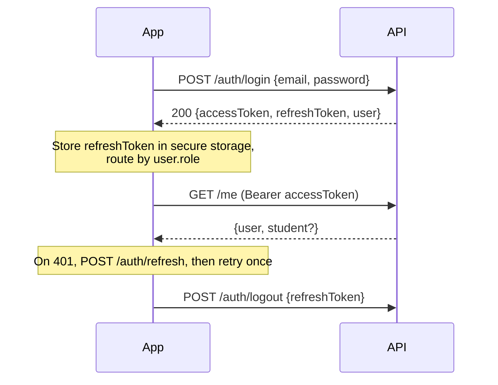
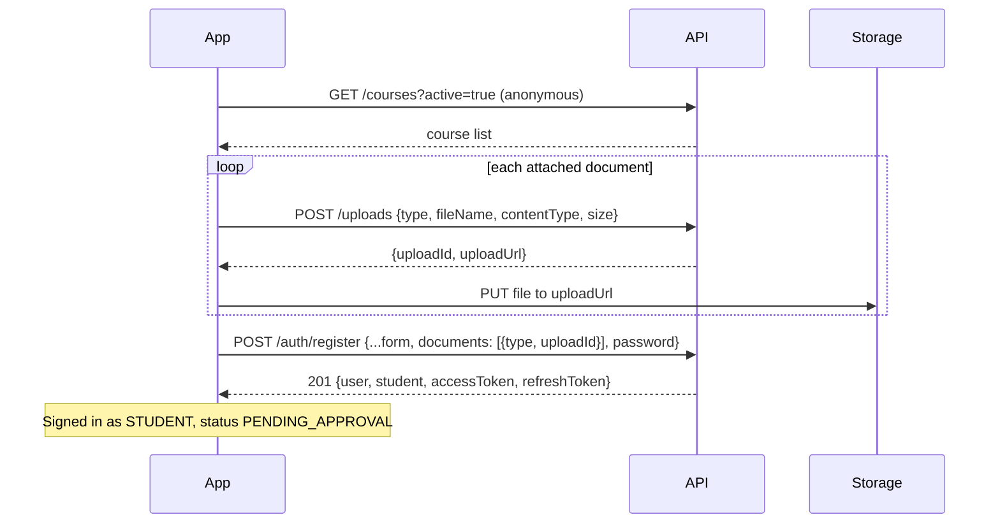
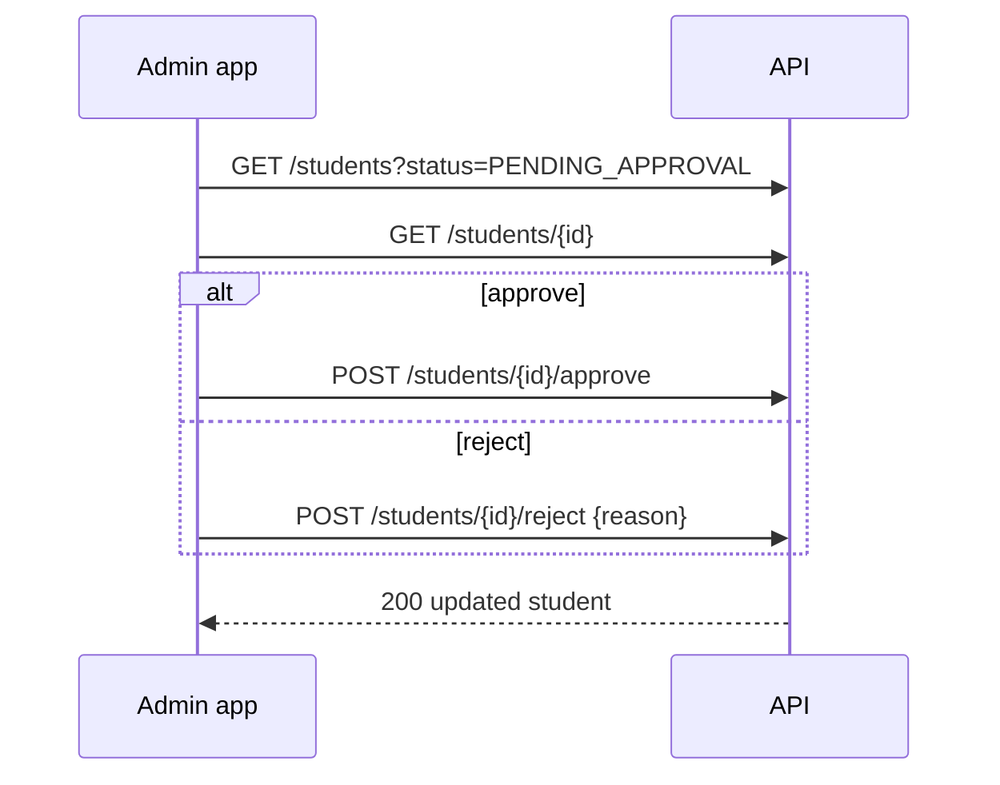
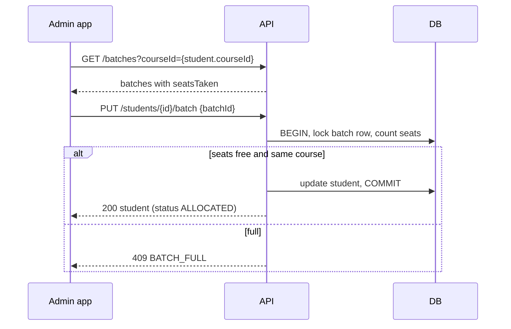
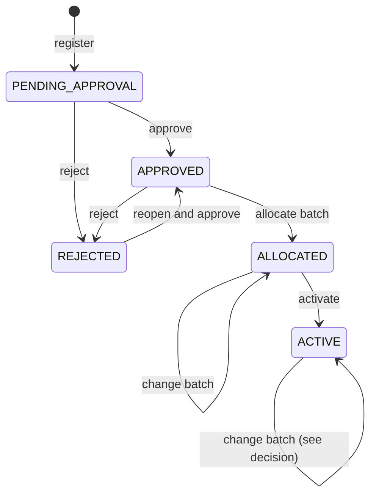
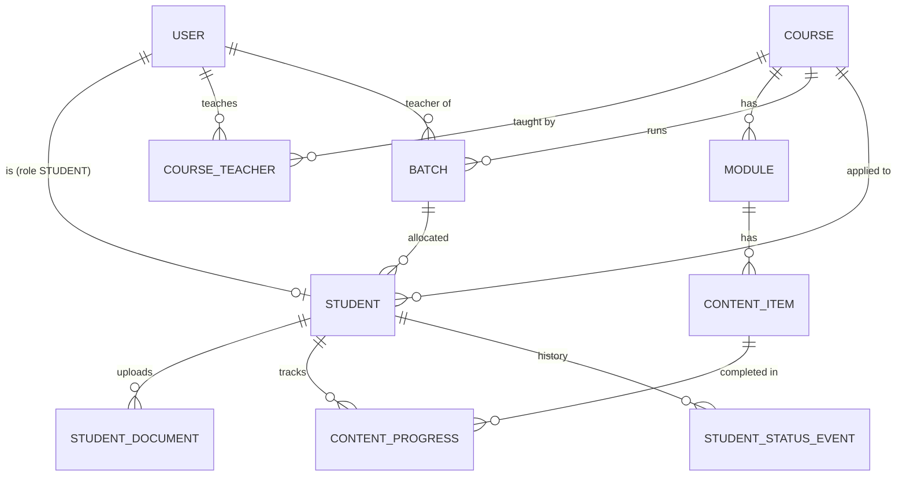

# API design: flows and data

**Status:** Draft, 13 Nov 2026
**Scope:** The backend API that replaces the in-memory mock in `src/services/api.ts`.

This document describes what the app already does against the mock, and what a real API must provide to support it. Each section has two parts: what exists today, and what to build. Decisions that still need an owner are marked **Decision needed** and collected in [Open questions](#10-open-questions).

## Contents

1. [Current state](#1-current-state)
2. [Roles and access](#2-roles-and-access)
3. [Core flows](#3-core-flows)
4. [Student lifecycle](#4-student-lifecycle)
5. [Data model](#5-data-model)
6. [API conventions](#6-api-conventions)
7. [Endpoints](#7-endpoints)
8. [Request and response shapes](#8-request-and-response-shapes)
9. [Client integration](#9-client-integration)
10. [Open questions](#10-open-questions)
11. [Build checklist](#11-build-checklist)

---

## 1. Current state

There is no backend. The data path is:

```
data/*.json              seed data
    ↓ deep-cloned at startup
src/data/db.ts           in-memory tables, mutated at runtime, reset on reload
    ↓
src/services/api.ts      async facade with fake latency (350 to 900 ms)
    ↓
src/context/AuthContext.tsx   session (user in memory only)
src/context/DataContext.tsx   all tables + selectors + actions
    ↓
app/**                   screens
```

`src/services/api.ts` is the only file that talks to `db`. Rewriting it to make HTTP calls is the intended swap point, and no screen imports `api` directly.

**Problems in the mock that a real API must not copy:**

| # | Problem | Where | Why it matters |
| --- | --- | --- | --- |
| P1 | `login` returns the full `User`, including `password` | `api.login` | Credentials leak to the client |
| P2 | Every table is loaded for every user, and loaded **before** sign-in (the register screen needs courses) | `DataContext.load` | Any client can read every student's email, phone, address and documents |
| P3 | Lifecycle actions don't check the current status (for example, you can activate a `PENDING_APPROVAL` student who has a batch) | `api.approve/reject/allocateBatch/activate` | Invalid states are possible |
| P4 | `allocateBatch` doesn't check that the batch belongs to the student's course | `api.allocateBatch` | Students can land in the wrong course's batch |
| P5 | The seat check is a read followed by a write | `api.allocateBatch` | Two admins can overfill a batch at the same moment |
| P6 | `toggleContentComplete` flips state | `api.toggleContentComplete` | A retried request undoes itself |
| P7 | IDs and registration numbers come from `array.length + 1` | `nextId`, `register` | Duplicates after deletes or concurrent writes |
| P8 | Every mutation reloads every table | `DataContext.run` | Slow, and it scales with the size of the whole database |
| P9 | Document "uploads" are fake records with a random size | `register.tsx` `attach()` | There is no file storage yet |
| P10 | The session isn't persisted | `AuthContext` | Users sign in again on every launch |

---

## 2. Roles and access

Three roles: `ADMIN`, `TEACHER` and `STUDENT`. The client routes by role (`app/_layout.tsx` `RoleGate`). The **server** must enforce the same rules, because a client-side gate is not security.

### Access matrix

| Resource | Anonymous | Student | Teacher | Admin |
| --- | --- | --- | --- | --- |
| Active course list (for registration) | Read | Read | Read | Read (including inactive) |
| Course, modules, content outline | – | Own course only | Assigned courses | All |
| Content file URLs | – | Own course, only when `ALLOCATED` or `ACTIVE` | Assigned courses | All |
| Batches | – | Own batch only | Batches they teach | All, and create |
| Student records (full) | – | Self only | Students in their batches | All |
| Classmates | – | Name and city only, same batch | – | – |
| Approve, reject, allocate, activate | – | – | – | Yes |
| Own content progress | – | Read and write | – | Read |
| Dashboard stats | – | – | – | Yes |
| Register | Yes | – | – | – |

The student batch screen shows only each classmate's name and city (`app/(student)/(tabs)/batch.tsx`). The API should return just those fields, not full student records.

---

## 3. Core flows

### 3.1 Sign in and session



- Today: `AuthContext.signIn` calls `api.login`. The user lives in React state and is lost on reload.
- Build: short-lived access token (about 15 min) and a rotating refresh token (about 30 days). On launch, the app restores the session from the refresh token before `RoleGate` decides where to go.
- Client dependency: `expo-secure-store` isn't installed yet. It's needed to store the refresh token.

### 3.2 Student registration

```
Personal → Contact → Education → Course → Documents + password → Submit
```



The server must validate every field again, even though the client already has. The client rules are in `app/(auth)/register.tsx` `validateStep`:

| Field | Rule |
| --- | --- |
| `fullName` | Required |
| `dob` | Required, `YYYY-MM-DD`, a real past date |
| `gender` | Required, one of `Male`, `Female`, `Other` |
| `bloodGroup` | Optional, one of `A+ A- B+ B- O+ O- AB+ AB-` |
| `email` | Required, valid format, unique (case-insensitive). Otherwise `409 EMAIL_TAKEN` |
| `phone` | Required, 10 digits |
| `altPhone`, `guardianName`, `guardianPhone` | Optional |
| `address`, `city`, `state` | Required |
| `pincode` | Optional, 6 digits if given |
| `education.qualification`, `education.institution` | Required |
| `education.board` | Optional |
| `education.yearOfPassing` | Required, 4 digits |
| `education.percentage` | Required, 0 to 100 |
| `courseId` | Required, must be an active course |
| `documents` | `PHOTO` and `ID_PROOF` required; `MARKSHEET` and `OTHER` optional; at most one per type |
| `password` | At least 6 characters. **Decision needed:** raise to 8 |

The server sets `status = PENDING_APPROVAL`, `appliedOn` and `registrationNo`. These fields are never accepted from the client.

### 3.3 Admin review



### 3.4 Batch allocation



The seat check and the write must happen in one transaction with the batch row locked (fixes P5).

### 3.5 Activation

`POST /students/{id}/activate` requires status `ALLOCATED` and a batch.

### 3.6 Learning and progress (student)

```
Course tab → GET /me/course           course + modules + per-module progress
Module     → GET /modules/{id}/content items + completed flags
Tick item  → PUT /me/progress/{contentId} {completed: true|false}
Open item  → GET /content/{id}/url     short-lived signed URL
```

- Content is locked until the student is `ALLOCATED` or `ACTIVE` (today this is `useCurrentStudent().hasCourseAccess`). The server returns the outline when locked, but `403 CONTENT_LOCKED` for file URLs and progress writes.
- Progress is set, not toggled, so retries are safe (fixes P6).

### 3.7 Teacher

```
Overview → GET /me/batches, GET /me/courses (with counts)
Students → GET /students?scope=mine&q=
Batch    → GET /batches/{id}, GET /batches/{id}/students
Content  → GET /courses/{id}/outline (read-only)
```

### 3.8 Admin dashboard

`GET /admin/stats` returns the counts per status and the totals the dashboard shows, plus the 5 most recent pending students: `GET /students?status=PENDING_APPROVAL&limit=5&sort=-appliedOn`.

---

## 4. Student lifecycle



### Transition rules (server-enforced)

Any transition not listed here returns `409 INVALID_TRANSITION`.

| From | Action | To | Preconditions | Side effects |
| --- | --- | --- | --- | --- |
| – | register | `PENDING_APPROVAL` | Valid payload, unique email | Create user and student; set `appliedOn` and `registrationNo` |
| `PENDING_APPROVAL` | approve | `APPROVED` | – | Set `reviewedOn` and `reviewedBy`; clear `rejectionReason` |
| `PENDING_APPROVAL`, `APPROVED` | reject | `REJECTED` | `reason` not empty | Set `reviewedOn`, `reviewedBy`, `rejectionReason`; clear `batchId` |
| `REJECTED` | approve | `APPROVED` | – | As approve (the UI calls this "Reopen and approve") |
| `APPROVED`, `ALLOCATED` | allocate | `ALLOCATED` | Batch exists, same course, not `COMPLETED`, seat free | Set `batchId` and `allocatedOn` |
| `ACTIVE` | allocate | **Decision needed** | Same as above | The mock moves the student back to `ALLOCATED`. Keeping `ACTIVE` is probably what an admin expects from "Change batch". |
| `ALLOCATED` | activate | `ACTIVE` | `batchId` set | – |

Record every transition in a `student_status_events` table (actor, from, to, reason, timestamp). The status timeline on the student and admin screens can then read real history instead of the three date fields.

---

## 5. Data model

### 5.1 Entities and relationships



### 5.2 Tables

Types are given as a guide; adapt them to the database you choose. `id` columns are server-generated (UUID or a database sequence), never `length + 1` (fixes P7).

**users**

| Column | Type | Notes |
| --- | --- | --- |
| `id` | id | PK |
| `role` | enum `ADMIN`, `TEACHER`, `STUDENT` | |
| `name` | text | |
| `email` | text | Unique, case-insensitive |
| `password_hash` | text | bcrypt or argon2. **Never returned** (fixes P1) |
| `phone` | text | |
| `designation` | text, null | Admin and teacher |
| `created_at`, `updated_at` | timestamp | |

Today, `User.courseIds` (teacher) becomes the `course_teachers` table. `User.studentId` becomes `students.user_id`. `avatarColor` is dropped, because the app now draws initials on a neutral surface.

**students**

| Column | Type | Notes |
| --- | --- | --- |
| `id` | id | PK |
| `user_id` | FK users | Unique |
| `registration_no` | text | Unique, `REG-{year}-{0001}` from a per-year sequence |
| `status` | enum (see §4) | Indexed |
| `full_name`, `dob`, `gender`, `blood_group` | | `dob` is a date |
| `email`, `phone`, `alt_phone` | | `email` matches the user's email |
| `address`, `city`, `state`, `pincode` | | |
| `guardian_name`, `guardian_phone` | | |
| `qualification`, `institution`, `board`, `year_of_passing`, `percentage` | | Today these are nested as `education`. Keep that shape in the API response. |
| `course_id` | FK courses | Indexed |
| `batch_id` | FK batches, null | Indexed |
| `applied_on` | date | |
| `reviewed_on`, `reviewed_by` | date, FK users | Today `reviewedBy` is a name string. Store the user ID and return the name. |
| `allocated_on` | date, null | |
| `rejection_reason` | text, null | |

**student_documents**

| Column | Type | Notes |
| --- | --- | --- |
| `id` | id | PK |
| `student_id` | FK | |
| `type` | enum `PHOTO`, `ID_PROOF`, `MARKSHEET`, `OTHER` | Unique per student |
| `file_name` | text | Original name |
| `storage_key` | text | Object storage key. Never sent to the client. |
| `content_type` | text | |
| `size_bytes` | int | Today the mock stores a string like `"1.2 MB"`. Format it in the client. |
| `uploaded_at` | timestamp | |

**courses**

| Column | Type | Notes |
| --- | --- | --- |
| `id`, `code` | | `code` is unique (`RN`, `FS`, …) |
| `title`, `tagline`, `description`, `level` | text | |
| `duration_weeks` | int | |
| `fee` | int | **Decision needed:** whole rupees (as today) or paise |
| `active` | bool | Only active courses accept registrations |
| `icon`, `color` | text | Seed data has them, but the redesigned UI doesn't use them. **Decision needed:** keep or drop. |

**course_teachers**: `course_id`, `user_id`, primary key on both.

**modules**: `id`, `course_id`, `order` (unique per course), `title`, `description`.

**content_items**

| Column | Type | Notes |
| --- | --- | --- |
| `id`, `module_id`, `course_id` | | `course_id` is denormalised for course-wide queries |
| `order` | int | Unique per module |
| `type` | enum `VIDEO`, `NOTES`, `ASSIGNMENT`, `IMAGE` | |
| `title`, `description` | text | |
| `duration_seconds` | int, null | Today a string like `"18 min"` |
| `file_name`, `storage_key`, `size_bytes` | | Today `url` is a public placeholder. Serve through signed URLs. |
| `due_date` | date, null | Assignments |
| `uploaded_at`, `uploaded_by` | timestamp, FK users | |

**batches**

| Column | Type | Notes |
| --- | --- | --- |
| `id`, `code` | | `code` is unique (`RN-SEP-2026-A`) |
| `course_id`, `teacher_id` | FK | |
| `start_date`, `end_date` | date | |
| `days` | text array | Today a display string (`"Monday - Friday"`). Store `["MON","TUE",…]` and format in the client. |
| `start_time`, `end_time` | time `HH:mm` | Today `"7:00 PM"`. Store 24-hour time; the client formats it. |
| `capacity` | int | Greater than 0 |
| `mode` | enum `Online`, `Offline`, `Hybrid` | |
| `room` | text | |
| `status` | enum `UPCOMING`, `RUNNING`, `COMPLETED` | **Decision needed:** stored, or derived from the dates |

The API adds `seatsTaken` (a count of students where `batch_id` matches) to every batch response. The client shouldn't count students itself.

**content_progress**: `student_id`, `content_id`, `completed_at`, primary key on both. This replaces `Student.completedContentIds`.

**student_status_events**: `id`, `student_id`, `from_status`, `to_status`, `actor_id`, `reason`, `created_at`.

---

## 6. API conventions

| Topic | Convention |
| --- | --- |
| Base URL | `https://<host>/api/v1`, set through `EXPO_PUBLIC_API_URL` |
| Format | JSON, `camelCase` keys (matching `src/types`) |
| Auth | `Authorization: Bearer <accessToken>` |
| IDs | Opaque strings. The client never builds or parses them. |
| Dates | `YYYY-MM-DD` for calendar dates. ISO 8601 UTC for timestamps. |
| Lists | `?limit=` (default 50, max 200) and `?cursor=`. Response: `{ items, nextCursor }` |
| Search | `?q=` matches name, registration no, email and phone (as on the admin students screen) |
| Sorting | `?sort=field` or `?sort=-field` |
| Mutations | Return the updated resource, so the client can update its cache without reloading |
| Retries | `PUT` and progress writes are idempotent. `POST /auth/register` accepts an `Idempotency-Key` header. |

### Errors

```json
{
  "error": {
    "code": "BATCH_FULL",
    "message": "RN-SEP-2026-A is already full",
    "fields": { "email": "An account with this email already exists" }
  }
}
```

`message` is written for display. The app shows it in a snackbar today, so it must read as plain user copy, not as a developer note. `fields` is present only on validation errors and maps to form fields.

| HTTP | `code` | When |
| --- | --- | --- |
| 400 | `BAD_REQUEST` | Malformed JSON or query |
| 401 | `UNAUTHENTICATED` | Missing or expired token |
| 401 | `INVALID_CREDENTIALS` | Wrong email or password (same message for both) |
| 403 | `FORBIDDEN` | Role or ownership check failed |
| 403 | `CONTENT_LOCKED` | Student isn't `ALLOCATED` or `ACTIVE` |
| 404 | `NOT_FOUND` | Missing resource, or one the caller may not see |
| 409 | `EMAIL_TAKEN` | Registration with an existing email |
| 409 | `BATCH_FULL` | No seats left |
| 409 | `INVALID_TRANSITION` | Action not allowed from the current status |
| 422 | `VALIDATION_FAILED` | Field errors, in `fields` |
| 429 | `RATE_LIMITED` | Login and registration throttling |
| 500 | `INTERNAL` | Anything else. Never leak stack traces. |

---

## 7. Endpoints

The **Mock today** column names the `api.ts` method each endpoint replaces.

### Auth and session

| Method | Path | Role | Mock today | Purpose |
| --- | --- | --- | --- | --- |
| POST | `/auth/login` | Anonymous | `login` | Returns tokens and user |
| POST | `/auth/refresh` | Anonymous | – | Rotates tokens |
| POST | `/auth/logout` | Any | – (`signOut` clears state) | Revokes the refresh token |
| POST | `/auth/register` | Anonymous | `register` | Creates user and student, returns tokens |
| GET | `/me` | Any | – | Current user, plus the student record for students |

### Uploads

| Method | Path | Role | Mock today | Purpose |
| --- | --- | --- | --- | --- |
| POST | `/uploads` | Anonymous (rate-limited) or any | – (`attach()` fakes it) | Returns `{uploadId, uploadUrl}` for a direct upload |
| GET | `/students/{id}/documents/{docId}/url` | Admin, self | – | Short-lived signed download URL |

Unused `uploadId`s expire after 24 hours.

### Courses and content

| Method | Path | Role | Mock today | Purpose |
| --- | --- | --- | --- | --- |
| GET | `/courses` | Anonymous: `active=true` only. Admin: all | `getCourses` | Course list, with `moduleCount` (the register screen shows it) |
| GET | `/courses/{id}` | Admin, teacher of course, enrolled student | `getCourse` | Course detail with counts (`modules`, `content`, `batches`, `students`) |
| GET | `/courses/{id}/outline` | Same | `getModules` + `getCourseContent` | Modules with their content items, in order |
| GET | `/modules/{id}/content` | Same | `getModuleContent` | Items in one module. For students, each item includes `completed`. |
| GET | `/content/{id}/url` | Same, student must have access | – (`Linking.openURL(item.url)`) | Signed file URL |
| GET | `/me/course` | Student | `useCurrentStudent` + selectors | Own course, modules with `done` and `total` per module, overall progress |
| PUT | `/me/progress/{contentId}` | Student | `toggleContentComplete` | Body `{completed: boolean}`. Returns the module's progress. |

### Batches

| Method | Path | Role | Mock today | Purpose |
| --- | --- | --- | --- | --- |
| GET | `/batches` | Admin. Teacher (own batches, forced) | `getBatches`, `getBatchesByCourse` | Filters: `courseId`, `teacherId`, `status`. Includes `seatsTaken`. |
| GET | `/batches/{id}` | Admin, teacher of batch, student in batch | `getBatch` | Detail with `seatsTaken` and `course` |
| POST | `/batches` | Admin | `createBatch` | Creates a batch |
| GET | `/batches/{id}/students` | Admin, teacher of batch | `studentsOfBatch` selector | Students in the batch (list projection) |
| GET | `/me/batch` | Student | `useCurrentStudent().batch` | Own batch |
| GET | `/me/batch/classmates` | Student | `studentsOfBatch` selector | `[{id, fullName, city}]` only |

### Students

| Method | Path | Role | Mock today | Purpose |
| --- | --- | --- | --- | --- |
| GET | `/students` | Admin. Teacher (own batches, forced) | `getStudents` | Filters: `status`, `courseId`, `batchId`, `q`. Returns the list projection. |
| GET | `/students/{id}` | Admin. Teacher (own batch). Self. | `getStudent` | Full record with documents and course/batch summaries |
| POST | `/students/{id}/approve` | Admin | `approve` | See §4 |
| POST | `/students/{id}/reject` | Admin | `reject` | Body `{reason}` |
| PUT | `/students/{id}/batch` | Admin | `allocateBatch` | Body `{batchId}`. Allocate or change batch. |
| POST | `/students/{id}/activate` | Admin | `activate` | See §4 |
| GET | `/students/{id}/history` | Admin, self | – | Status events, for the timeline |

### Admin

| Method | Path | Role | Mock today | Purpose |
| --- | --- | --- | --- | --- |
| GET | `/admin/stats` | Admin | `getStats` | Counts per status and totals |
| POST | `/dev/reset` | Admin, **demo environment only** | `reset` | Reloads the seed data. Must not exist in production. |

### Not in the app yet (likely next)

Course, module and content create/update/delete. Batch edit and delete. Teacher accounts management. Content upload for teachers. Notifications when a student's status changes.

---

## 8. Request and response shapes

### Login

```http
POST /auth/login
{ "email": "admin@ams.dev", "password": "admin123" }
```

```json
{
  "accessToken": "…",
  "refreshToken": "…",
  "user": {
    "id": "usr_…",
    "role": "ADMIN",
    "name": "…",
    "email": "admin@ams.dev",
    "phone": "…",
    "designation": "Academic Administrator"
  }
}
```

For a teacher, `user` also carries `courseIds`. For a student, `/me` adds `student` (see below).

### Register

```http
POST /auth/register
Idempotency-Key: 3f1c…
```

```json
{
  "fullName": "Ananya Sharma",
  "dob": "2003-05-21",
  "gender": "Female",
  "bloodGroup": "B+",
  "email": "ananya.sharma@example.com",
  "phone": "9876543210",
  "altPhone": "",
  "address": "…",
  "city": "Pune",
  "state": "Maharashtra",
  "pincode": "411001",
  "guardianName": "…",
  "guardianPhone": "…",
  "education": {
    "qualification": "B.Sc",
    "institution": "…",
    "board": "",
    "yearOfPassing": 2024,
    "percentage": 78.5
  },
  "courseId": "crs_…",
  "documents": [
    { "type": "PHOTO", "uploadId": "upl_…" },
    { "type": "ID_PROOF", "uploadId": "upl_…" }
  ],
  "password": "…"
}
```

The response is `201` with the same body as login, plus `student` (full shape).

### Student: list projection

Used by `GET /students` and `GET /batches/{id}/students`. It contains what `StudentRow` shows:

```json
{
  "id": "stu_…",
  "registrationNo": "REG-2026-0001",
  "fullName": "…",
  "status": "PENDING_APPROVAL",
  "appliedOn": "2026-09-02",
  "course": { "id": "crs_…", "title": "…" },
  "batch": { "id": "bth_…", "code": "RN-SEP-2026-A" }
}
```

### Student: full

This is the current `Student` type with these changes:

- `completedContentIds` is removed. Progress comes from `/me/course` and `/modules/{id}/content`.
- `avatarColor` is removed.
- `reviewedBy` becomes `{ id, name }`.
- `documents[]` becomes `{ id, type, fileName, sizeBytes, uploadedAt }`. There is no URL; the client fetches a signed one on demand.
- `course` and `batch` summaries are added (`id` with `title` or `code`), so detail screens need one request.

### Batch

The current `Batch` type with these changes:

- `seatsTaken: number` and `course: { id, title, code }` are added.
- `days` becomes a string array, and `startTime`/`endTime` become `HH:mm` (see §5.2). `BatchRow` and the batch screens format them for display.

### Student course (`GET /me/course`)

```json
{
  "course": { "id": "crs_…", "title": "…", "tagline": "…" },
  "locked": false,
  "progress": { "done": 7, "total": 24 },
  "modules": [
    { "id": "mod_…", "order": 1, "title": "…", "done": 3, "total": 3 }
  ]
}
```

This feeds the progress rings on the student home, course and module screens directly. The client stops computing `percent(done, total)` from the full content table.

### Progress write

```http
PUT /me/progress/cnt_123
{ "completed": true }
```

```json
{ "contentId": "cnt_123", "completed": true, "module": { "id": "mod_…", "done": 4, "total": 6 }, "course": { "done": 8, "total": 24 } }
```

---

## 9. Client integration

### 9.1 Where the change happens

| File | Change |
| --- | --- |
| `src/services/api.ts` | Replace the `db` calls with HTTP calls (axios is already installed). Keep the method names where possible. Add a single client with the base URL, the auth header, refresh-on-401, and mapping of the error envelope to `Error(message)`. |
| `src/context/AuthContext.tsx` | Store tokens. Restore the session on launch (`booting` already exists and is currently always `false`). Call `/auth/logout` on sign-out. |
| `src/context/DataContext.tsx` | Stop loading every table up front (fixes P2 and P8). Load per screen, scoped by role. Apply returned resources to local state after mutations instead of calling `load()`. |
| `src/hooks/useCurrentStudent.ts` | Read from `/me`, `/me/course` and `/me/batch`. |
| `app/(auth)/register.tsx` | Upload real files (`expo-document-picker` / `expo-image-picker`, neither installed yet) through `/uploads`, then submit `uploadId`s. |
| `src/types/index.ts` | Align with the response shapes in §8. Remove `password` from `User`. |
| `src/data/db.ts`, `data/*.json` | Keep for a mock mode (`EXPO_PUBLIC_API_URL` unset) or delete. **Decision needed.** |

**Decision needed:** a caching library. TanStack Query would cover per-screen loading, pull-to-refresh, retry and cache updates after mutations. That removes most of `DataContext`. The alternative is to keep `DataContext` and add per-resource loading by hand.

### 9.2 Screen to endpoint map

| Screen | File | Reads | Writes |
| --- | --- | --- | --- |
| Login | `app/(auth)/login.tsx` | – | `POST /auth/login` |
| Register | `app/(auth)/register.tsx` | `GET /courses?active=true` | `POST /uploads`, `POST /auth/register` |
| Admin dashboard | `app/(admin)/(tabs)/index.tsx` | `GET /admin/stats`, `GET /students?status=PENDING_APPROVAL&limit=5` | – |
| Admin students | `app/(admin)/(tabs)/students.tsx` | `GET /students?status=&q=`, counts from `/admin/stats` | – |
| Admin courses | `app/(admin)/(tabs)/courses.tsx` | `GET /courses` (with counts) | – |
| Admin batches | `app/(admin)/(tabs)/batches.tsx` | `GET /batches?courseId=`, `GET /courses` (filter chips) | – |
| Admin student detail | `app/(admin)/student/[id].tsx` | `GET /students/{id}`, `GET /batches?courseId=` (picker) | approve, reject, `PUT …/batch`, activate |
| Admin course detail | `app/(admin)/course/[id].tsx` | `GET /courses/{id}`, `/courses/{id}/outline`, `/batches?courseId=` | – |
| Admin batch detail | `app/(admin)/batch/[id].tsx` | `GET /batches/{id}`, `/batches/{id}/students` | – |
| Teacher overview | `app/(teacher)/(tabs)/index.tsx` | `GET /batches` (scoped), `GET /courses/{id}` per assigned course | – |
| Teacher students | `app/(teacher)/(tabs)/students.tsx` | `GET /students?q=` (scoped) | – |
| Teacher content | `app/(teacher)/(tabs)/content.tsx` | `GET /courses/{id}/outline` per assigned course | – |
| Teacher batch detail | `app/(teacher)/batch/[id].tsx` | `GET /batches/{id}`, `/batches/{id}/students` | – |
| Student home | `app/(student)/(tabs)/index.tsx` | `GET /me`, `/me/course`, `/me/batch`, `/students/{id}/history` | – |
| Student course | `app/(student)/(tabs)/course.tsx` | `GET /me/course` | – |
| Student batch | `app/(student)/(tabs)/batch.tsx` | `GET /me/batch`, `/me/batch/classmates` | – |
| Student profile | `app/(student)/(tabs)/profile.tsx` | `GET /me` | `POST /auth/logout` |
| Module detail | `app/(student)/module/[id].tsx` | `GET /modules/{id}/content` | `PUT /me/progress/{id}`, `GET /content/{id}/url` |

### 9.3 Loading, error and empty states

The screens already handle these through `useDataGate` (skeleton, error with Try again, then empty). Keep that contract: a screen never shows "not found" or an empty state while its request is still in flight. A failed refresh keeps the last good data on screen, as `DataContext` does today.

---

## 10. Open questions

| # | Question | Default if nobody decides |
| --- | --- | --- |
| Q1 | Does "Change batch" on an `ACTIVE` student keep them `ACTIVE`, or move them back to `ALLOCATED` (as the mock does)? | Keep `ACTIVE` |
| Q2 | Minimum password length: 6 (as today) or 8? | 8 |
| Q3 | Fee in whole rupees or paise? | Whole rupees (integer) |
| Q4 | Is batch `status` stored, or derived from the dates? | Derived, with a manual `COMPLETED` override |
| Q5 | Keep `course.icon` and `course.color`? | Drop them; the UI doesn't use them |
| Q6 | Keep a mock mode (local JSON) after the API exists? | Yes, when `EXPO_PUBLIC_API_URL` is unset, for demos and UI work |
| Q7 | Use TanStack Query, or extend `DataContext`? | TanStack Query |
| Q8 | Can a teacher teach several courses? (`courseIds` is already an array) | Yes |
| Q9 | Can a rejected student re-apply with the same email, or only be reopened by an admin? | Reopen only |
| Q10 | Can a student withdraw, or can an admin remove a student from a batch without rejecting them? | Out of scope for v1 |
| Q11 | Backend stack and hosting (language, database, object storage) | Not decided |
| Q12 | App name: `IGCA` (app.json) or "Student Management" (login screen)? The API's email sender name depends on it. | Not decided |

---

## 11. Build checklist

**Backend**

- [ ] Schema and migrations for the tables in §5.2, with seed data from `data/*.json`
- [ ] Auth: login, refresh, logout, password hashing, rate limits
- [ ] Role and ownership middleware matching §2
- [ ] Courses, outline and content endpoints, with signed file URLs
- [ ] Upload flow and object storage
- [ ] Registration with server-side validation, idempotency and a per-year registration-number sequence
- [ ] Lifecycle actions with transition checks, transactional seat allocation and status events
- [ ] Progress endpoints
- [ ] Admin stats
- [ ] Error envelope and codes from §6
- [ ] Tests for every transition in §4, the seat race, and the access matrix

**App**

- [ ] HTTP client in `src/services/api.ts` (base URL, auth, refresh, error mapping)
- [ ] Session persistence (`expo-secure-store`) and boot restore
- [ ] Per-screen, role-scoped loading instead of the global load
- [ ] Real document picking and upload in registration
- [ ] Types updated to §8; formatting of times, days and sizes moved into the client
- [ ] Mock mode kept behind `EXPO_PUBLIC_API_URL` (if Q6 = yes)
- [ ] Update `README.md` and `data/README.md`
